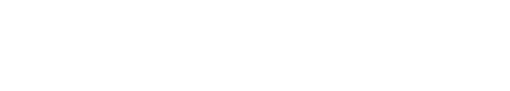
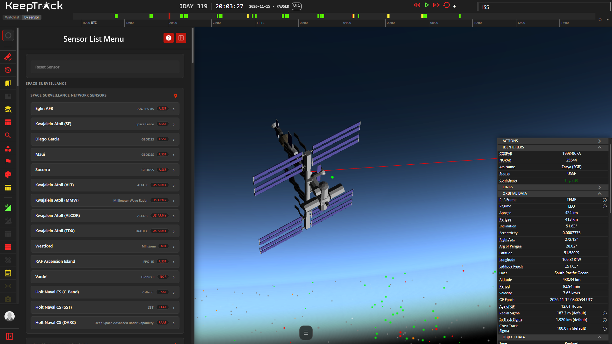

 

<picture>
  <source media="(prefers-color-scheme: dark)" srcset="./public/img/logo.png">
  <source media="(prefers-color-scheme: light)" srcset="./public/img/logo-light.png">
  
</picture>

KeepTrack is a browser-based application for visualizing satellites, space debris,
and the solar system. Explore orbits, predict passes over ground sensors, and
build satellite demonstrations using TypeScript and WebGL 2.

[Open the app](https://app.keeptrack.space) ·
[User documentation](https://docs.keeptrack.space) ·
[Contribute](CONTRIBUTING.md) ·
[Releases](https://github.com/thkruz/keeptrack.space/releases) ·
[Discord](https://discord.gg/G4tJfSkmzx)



## What you can do

- Search the satellite catalog by name or NORAD ID and inspect orbital data.
- Explore orbit paths, ground tracks, and satellite positions at different times.
- Visualize sensor coverage and calculate satellite look angles and passes.
- Load your own orbital data and explore launch and breakup simulations.
- Generate Walker constellations to study coverage and spacing.
- Show times in UTC, your local zone, or the selected sensor site's zone.
- Export images, videos, and data files that carry KeepTrack branding.
- Switch between Earth, planetarium, and solar-system views for demonstrations.
- Use the app on a phone, with a touch layout and menus sized for small screens.

The hosted app includes commercial features from a private Pro module. This
repository contains the open-source application; you do not need access to Pro
to build it or contribute. Feature availability depends on the build and account.

### Data and performance

Satellite positions are calculated from orbital data, rather than measured live
by the browser. Predictions depend on the source data, its age, and the propagation
model; changing the simulation date does not retrieve a historical catalog.

The default app fetches catalog data and other resources over the network. Offline
use requires preparing the data and assets you need in advance. Loading time and
frame rate vary with the device, graphics settings, and catalog size.

## Run locally

Use **Node.js 24+**, **pnpm 10+**, and **Git**. The exact pnpm version is recorded in
`package.json`. A browser with **WebGL 2** support is required.

```bash
git clone https://github.com/thkruz/keeptrack.space
cd keeptrack.space

# Initialize the public orbital mechanics library.
git submodule update --init --recursive -- src/engine/ootk

corepack enable
pnpm install --frozen-lockfile
pnpm start
```

Open **http://localhost:5544** after the initial build finishes. The first load
requires network access to retrieve catalog data. If Corepack is unavailable,
install the pnpm version listed in `package.json` before running the install step.

The public submodule command above is intentional: initializing every submodule
also attempts to fetch the private Pro repository.

| Command | Purpose |
| --- | --- |
| `pnpm start` | Build and serve the OSS app during development |
| `pnpm run build` | Create a production build in `dist/` |
| `pnpm run lint` | Check source formatting and lint rules with Biome |
| `pnpm run typecheck` | Check TypeScript types |
| `pnpm test` | Run unit tests with Vitest |
| `pnpm run test:e2e:smoke` | Run the Playwright boot check against a built app |

See [Contributing](CONTRIBUTING.md) for the development workflow and
[Testing](docs/regression-testing.md) for browser-test setup.

### Troubleshooting

- **Port 5544 is occupied:** stop the conflicting server or set
  `KEEPTRACK_DEV_PORT` to a free port before starting. Playwright is configured
  for port 5544 by default.
- **Missing OOTK imports:** run the public submodule initialization command above.
- **Blank screen:** inspect the browser console and verify that WebGL 2 is
  available with your browser and graphics driver.
- **Catalog does not load:** inspect failed requests in the browser's Network tab;
  the default catalog requires access to `api.keeptrack.space`.

When reporting a problem, include the commit or version, browser, operating
system, reproduction steps, and relevant console errors.

## Developer documentation

- [Contributing](CONTRIBUTING.md): setup, checks, and pull requests.
- [Architecture](docs/technical.md): source layout, rendering, workers, and builds.
- [External plugins](src/plugins-external/README.md): installing and developing plugins.
- [Plugin API](docs/plugin-api.md): supported imports and compatibility rules.
- [Testing](docs/regression-testing.md): automated checks and manual verification.
- [Scripts](scripts/README.md): development and diagnostic tools.

The app uses TypeScript, WebGL 2, OOTK, Web Workers, and Materialize CSS. Rspack
builds the application; Vitest, Playwright, and Biome provide development checks.

## Releases

See [GitHub Releases](https://github.com/thkruz/keeptrack.space/releases) for
published versions and the [generated changelog](docs/CHANGELOG.md) for detailed
change history. Release automation updates the changelog and version badge.

## Community and contributions

Report bugs through [GitHub Issues](https://github.com/thkruz/keeptrack.space/issues).
For questions, use [Discussions](https://github.com/thkruz/keeptrack.space/discussions)
or [Discord](https://discord.gg/G4tJfSkmzx). Report vulnerabilities privately as
described in the [security policy](SECURITY.md).

Contributions should follow the [contributing guide](CONTRIBUTING.md) and
[code of conduct](CODE_OF_CONDUCT.md).

Thanks to the contributors who have helped build and test KeepTrack:

- [@hkruczek](https://github.com/hkruczek/) - Features and testing
- [@Le-Roi777](https://github.com/Le-Roi777/) - UI/UX design and implementation
- [@norbertpouzin](https://github.com/norbertpouzin/) - Plugin development
- [@Koroviev-and-Begemot](https://github.com/Koroviev-and-Begemot/) - Plugin development
- [@RylandAdams](https://github.com/RylandAdams/) - Plugin development
- [@cwang-pivotal](https://github.com/cwang-pivotal/) - Bug fixes and improvements
- [@roop37](https://github.com/roop37/) - Most Tracked plugin

KeepTrack began with James Yoder's [Stuff in Space](https://github.com/jeyoder/StuffInSpace/),
originally released under the MIT License.

## License and trademarks

See [LICENSE](LICENSE) for the GNU Affero General Public License, version 3.

KeepTrack™ and KeepTrack.space™ are trademarks of Kruczek Labs LLC. You may use
these names to refer to this software, including “powered by KeepTrack” or “based
on KeepTrack.” Do not use them in your product name or domain, or imply endorsement
without permission.
